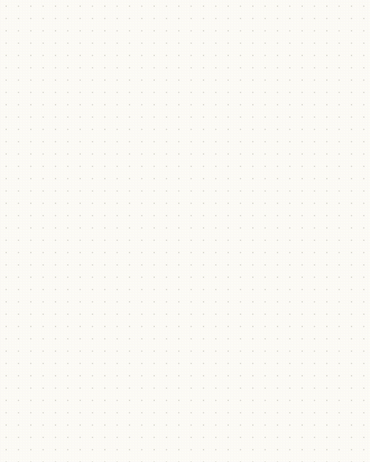

# Web Design Styles MCP 

> **16 curated, self-contained HTML/CSS design systems and specifications for AI coding agents.**

[](https://modelcontextprotocol.io)
[](https://web-design-styles-mcp.anilgoud-gunda.workers.dev)
[](https://web-design-styles-mcp.anilgoud-gunda.workers.dev)
[](https://web-design-styles-mcp.anilgoud-gunda.workers.dev)

---

## Showcase

<p align="center">
  
</p>

<p align="center">
  ▶️ <b><a href="media/mcp-launch.mp4">Watch the full video walkthrough with sound & voiceover (MP4)</a></b> &nbsp;|&nbsp; 🌐 <b><a href="https://web-design-styles-mcp.anilgoud-gunda.workers.dev">Interactive Web Showcase</a></b>
</p>

---

##  The Problem

Every AI coding assistant (Cursor, Claude, Copilot, Windsurf) defaults to the exact same frontend aesthetics:
- The predictable purple-to-pink gradient hero
- Generic rounded white/dark cards with subtle drop shadows
- Stock Inter or Roboto typography
- Zero distinct brand personality

AI models can write intricate backend logic in seconds, but without explicit design system constraints, their UI always looks like a cookie-cutter template.

**Web Design Styles MCP** solves this by equipping your AI agents with 16 production-grade, battle-tested design systems—including exact `:root` CSS variables, border physics, typography hierarchies, layout laws, and reference templates.

---

##  Quick Install

This MCP server is **remotely hosted** and **completely stateless**—no local runtime setup, dependencies, or node installations required.

The remote MCP endpoint:
```
https://web-design-styles-mcp.anilgoud-gunda.workers.dev/mcp
```

### 1. Claude Desktop

**Via CLI:**
```bash
claude mcp add --transport http web-design-styles https://web-design-styles-mcp.anilgoud-gunda.workers.dev/mcp
```

**Or add to your `claude_desktop_config.json`:**
```json
{
  "mcpServers": {
    "web-design-styles": {
      "url": "https://web-design-styles-mcp.anilgoud-gunda.workers.dev/mcp"
    }
  }
}
```

---

### 2. Cursor

Add to your `.cursor/mcp.json` or open **Cursor Settings → MCP → Add New MCP Server**:

```json
{
  "mcpServers": {
    "web-design-styles": {
      "url": "https://web-design-styles-mcp.anilgoud-gunda.workers.dev/mcp"
    }
  }
}
```

---

### 3. Windsurf

Add to `~/.codeium/windsurf/mcp_config.json`:

```json
{
  "mcpServers": {
    "web-design-styles": {
      "serverUrl": "https://web-design-styles-mcp.anilgoud-gunda.workers.dev/mcp"
    }
  }
}
```

---

### 4. OpenCode

Add to your `opencode.json`:

```json
{
  "mcp": {
    "servers": {
      "web-design-styles": {
        "type": "remote",
        "url": "https://web-design-styles-mcp.anilgoud-gunda.workers.dev/mcp",
        "oauth": false
      }
    }
  }
}
```

---

### 5. VS Code / Cline / Roo Code / LibreChat

Configure as a remote **HTTP / SSE** MCP server:
- **Server Name:** `web-design-styles`
- **Server URL:** `https://web-design-styles-mcp.anilgoud-gunda.workers.dev/mcp`
- **Transport:** `HTTP (streamable)`

---

##  Available MCP Tools

Once installed, your AI agent automatically has access to 4 specialized design tools:

| Tool | Description | Example Usage |
| :--- | :--- | :--- |
| `list_design_styles` | Browse all 16 aesthetics with IDs, color palettes, theme, typography, and ideal use cases. Supports keyword (`brutalist`, `retro`, `dark`) and theme filters (`light`/`dark`). | *"List all retro design styles available."* |
| `get_design_style` | Fetch the complete design specification, exact `:root` CSS custom properties, layout physics, and self-contained reference HTML/CSS showcase. | *"Get the design blueprint for style 16."* |
| `recommend_design_style` | Analyzes your project description and recommends the top 3 best-fitting styles with rationales and ready-to-use tokens. | *"Recommend 3 styles for a CLI developer tool landing page."* |
| `apply_design_style` | Provides prompt instructions to refactor an existing component or page into a chosen style without changing the original content or functionality. | *"Restyle this hero section into Swiss Brutalist."* |

---

##  The 16 Curated Design Systems

| # | Style Name | Theme | Key Aesthetics | Best For |
| :-: | :--- | :-: | :--- | :--- |
| **01** | **Swiss International Typographic** | Light | Asymmetric grid, bold red accent, heavy grotesque display | Corporate landing pages, editorial reports, architecture portfolios |
| **02** | **Swiss Brutalist** | Light | Raw structural wireframes, industrial yellow hazard accents, exposed borders | Developer platforms, tech events, design agencies |
| **03** | **Pixel Mono Retro-Tech** | Dark | High-contrast neon green, terminal scanlines, monospaced ASCII grids | CLI documentation, cyber-security dashboards, developer tools |
| **04** | **Tactile Hardware Receipt** | Light | Thermal receipt paper texture, dot-matrix fonts, barcode accents | E-commerce checkout, invoice generators, fintech audits |
| **05** | **Glassmorphism Dark UI** | Dark | Frosted backdrop blur, translucent glass layers, glowing ambient gradients | Web3 dApps, premium SaaS dashboards, analytics platforms |
| **06** | **Brutalist Minimal Audio** | Dark | Raw concrete grey, blaze orange accents, industrial hardware dials | Audio gear stores, music production apps, synthesizer interfaces |
| **07** | **Editorial Ink Print** | Light | Warm newsprint parchment, deep serif typography, burgundy drop-caps | Long-form essays, literary journals, research blogs |
| **08** | **Pixel Arcade Retro 90s** | Dark | Synthwave purple & hot pink, 16-bit raster badges, glowing neon grids | Indie game showcases, retro tech blogs, creative portfolios |
| **09** | **Vintage Sign-Paint Craft** | Light | Aged cream paper, hand-lettered bold serifs, rustic crimson accents | Artisan bakeries, coffee roasters, heritage lifestyle brands |
| **10** | **Retro Mac OS Monochrome** | Light | 1-bit dithered patterns, classic System 7 window chrome, Chicago font | Minimalist portfolios, retro software showcases, utility tools |
| **11** | **Dark Developer Obsidian** | Dark | Obsidian slate background, GitHub-style syntax badges, electric blue accents | Open-source docs, developer portfolios, API portals |
| **12** | **Retro Windows 98** | Light | Classic beveled 3D borders, Win98 taskbars, navy title bars | Retro web toys, 90s nostalgia apps, interactive demos |
| **13** | **Retro 8-bit NES Gaming** | Dark | Pure black CRT background, Nintendo red & gold, pixel sprite borders | Game jam portfolios, emulator hubs, retro hardware blogs |
| **14** | **Minimal Monochrome Gallery** | Light | Stark gallery white, high-fashion serif titles, generous whitespace | Luxury fashion, photography galleries, architecture monographs |
| **15** | **Pop-Brutalist Bold Fintech** | Light/Dark | Bubblegum pink & cyber black, heavy offset drop shadows, pill badges | Gen-Z consumer apps, neo-banks, creator economies |
| **16** | **BlockFrame Neobrutalist** | Light | Bold 4px black borders, pastel color blocks, raw drop shadows | Modern SaaS, interactive developer tools, product launch pages |

---

##  Example Prompts for Your AI Agent

Once connected, you can guide your agent with natural language:

```text
"Use the web-design-styles MCP to find a high-contrast dark aesthetic for my analytics dashboard, then build the hero component."
```

```text
"Recommend the top 3 styles from web-design-styles for a developer CLI portfolio."
```

```text
"Get the design specification for Style 16 (BlockFrame Neobrutalist) and use its exact tokens and border physics to style this pricing table."
```

```text
"Refactor my current landing page using Style 01 (Swiss International Typographic). Keep all real content intact."
```

---

##  Live Interactive Showcase

Explore the live reference sheets, copy CSS tokens, and preview interactive components directly in your browser:

 **[https://web-design-styles-mcp.anilgoud-gunda.workers.dev](https://web-design-styles-mcp.anilgoud-gunda.workers.dev)**

---

## 👤 Author

Crafted by **Anil Goud Gunda**  
- LinkedIn: [Connect on LinkedIn](https://www.linkedin.com)
- Web Showcase: [web-design-styles-mcp.anilgoud-gunda.workers.dev](https://web-design-styles-mcp.anilgoud-gunda.workers.dev)
